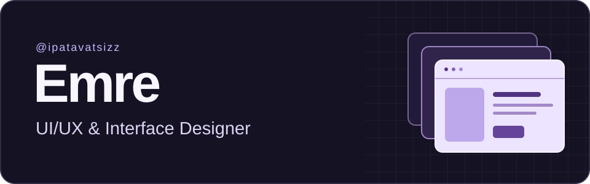

  

  
  
  
  

## ✦ About me

I’m **Emre Döğer**, a UI/UX and interface designer with a background in coding. I work across web, desktop, and games, from designing reusable interface components to refining how they feel in a working build. I pay particular attention to typography, spacing, motion, and interaction feedback.

- **UI/UX design** — User-centered interfaces with a distinct visual identity.
- **Web interfaces** — Translating designs into web experiences with Vue, React, and Tailwind CSS.
- **Design systems** — Reusable components and style guides that keep products consistent as they grow.

## ✦ Selected work

- 🏨 **[Lobby Pop](https://moonshred.net/projects/lobby-pop/)** · A hotel management game I’m developing in Godot. I work on the in-game interface, guest interactions, and the 3D spaces players move through.
- 🌙 **[Moonshred](https://moonshred.net/)** · The bilingual website I built for my indie game work, with a dedicated page for Lobby Pop.
- 📦 **[ZombieBuddy Installer](https://github.com/ipatavatsizz/zbinstaller)** · A cross-platform desktop installer for the ZombieBuddy mod for Project Zomboid.
- 🎧 **[YTubic](https://github.com/NUber-dev/YTubic/pull/133)** · An open-source contribution to a YouTube Music desktop client, fixing Repeat One playback on WebKit.

## ✦ Tools

See the full toolkit

- **Design** · Figma
- **Frontend** · Vue, React, Vite, Tailwind CSS, TypeScript, JavaScript, HTML, CSS
- **Game development & 3D** · Godot, GDScript, Blender

## ✦ The Maestro

  
   
  <em>“Je tua del jan il mio pado kilever.”</em>

